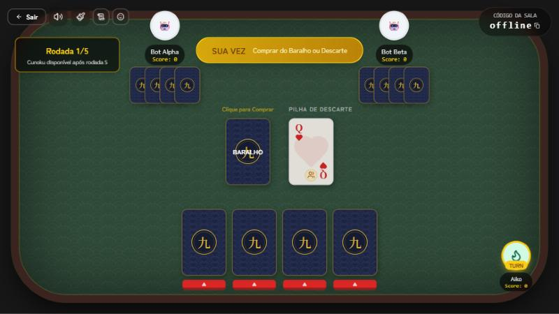
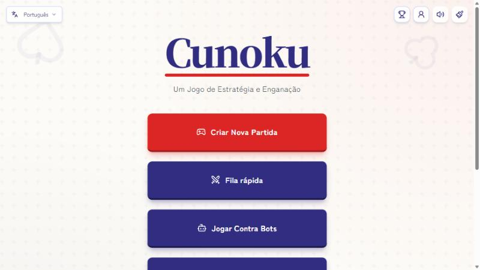
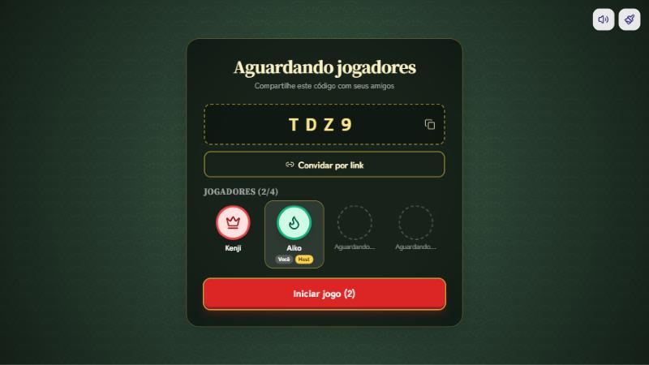
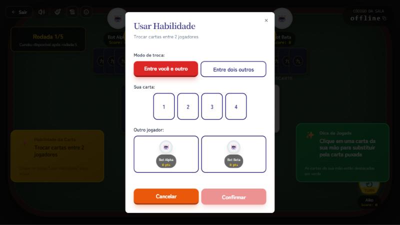
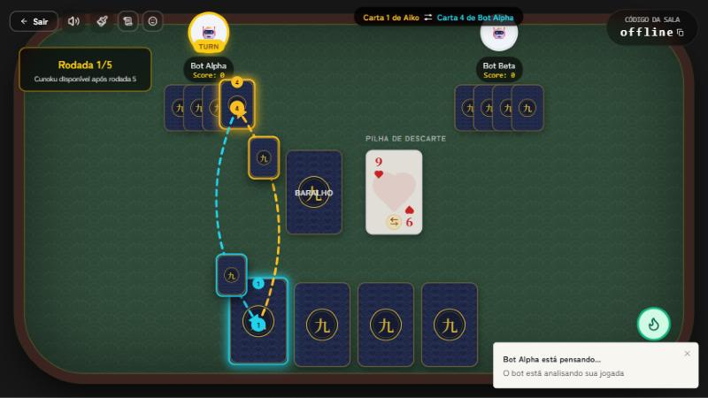
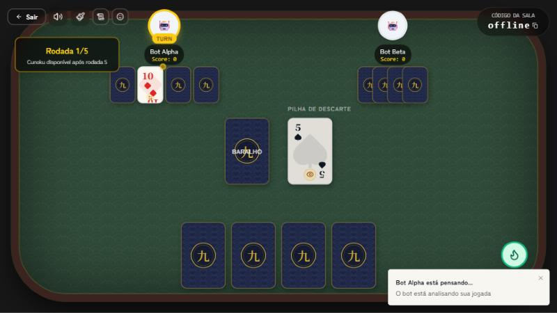

<div align="center">

# Cunoku 九

**Um jogo de cartas de estratégia e blefe, com tema de mesa japonesa.**

Termine a partida com a **menor soma de cartas**, mesmo sem poder ver a própria mão.

[](https://github.com/MatheusPereira64/CunokuGame/releases/latest)
[](https://github.com/MatheusPereira64/CunokuGame/actions/workflows/ci.yml)

[**Jogar no navegador**](https://cunoku.cunokugame.workers.dev) · [**Baixar para Android**](https://github.com/MatheusPereira64/CunokuGame/releases/latest) · [Regras](#como-jogar) · [Rodar localmente](#rodar-localmente)



</div>

## O que tem no jogo

- **Jogue como quiser:** sala com amigos por código ou link, fila rápida, partida contra bots (fácil, médio ou difícil) e Wi‑Fi local
- **Competição:** desafio diário, liga semanal e ranking com contas salvas no aparelho
- **Seu estilo:** ícones e cores de perfil, temas de mesa e emotes durante a partida
- **Três idiomas:** português, espanhol e inglês
- **Em qualquer tela:** navegador e app Android, com layout próprio para celular deitado

## Telas

<table>
  <tr>
    <td width="50%"><br><sub>Menu inicial</sub></td>
    <td width="50%"><br><sub>Sala de espera, com um assento para cada jogador</sub></td>
  </tr>
  <tr>
    <td><br><sub>Janela de habilidade</sub></td>
    <td><br><sub>Troca: as setas ligam as duas cartas trocadas</sub></td>
  </tr>
  <tr>
    <td><br><sub>Carta de oponente revelada, só para quem usou o poder</sub></td>
    <td><br><sub>Quando alguém declara Cunoku, as rodadas finais começam</sub></td>
  </tr>
</table>

## Como jogar

### Objetivo

Ter a **menor soma de cartas** quando a partida acabar. Cada jogador começa com 4 cartas viradas para baixo, e ninguém sabe o que tem na mão até usar um poder. A partida aceita de 2 a 6 jogadores.

### Valor das cartas

| Carta | Pontos |
|---|---|
| Coringa | **-1** |
| Rei | **0** |
| Ás | 1 |
| 2 a 10 | o próprio número |
| Valete | 11 |
| Rainha | 12 |

### Seu turno

1. **Compre** uma carta do baralho ou pegue a de cima da pilha de descarte.
2. **Decida** o que fazer com ela:
   - substituir uma carta da sua mão, descartando a antiga;
   - descartá-la direto na pilha;
   - usar o poder dela, se a carta veio do baralho. Carta pega do descarte não usa poder.

### Poderes

| Carta | Poder |
|---|---|
| **Ás e 2** (Vento 風) | Embaralha a mão de um oponente, que esquece o que sabia sobre ela. Todos veem quem foi atingido, e a soma dele não muda. |
| **3 e 4** (Selo) | Sela uma carta da mesa: ela não pode ser vista, trocada nem descartada até chegar de novo a sua vez. |
| **5 e 6** | Olha uma carta de um oponente. Ela fica revelada por 20 segundos, só para você. |
| **7 e 8** | Olha uma carta sua por 20 segundos. |
| **9 e 10** | Faz 2 jogadores trocarem 1 carta: você e outro, ou dois outros jogadores. |
| **Valete** | Você compra outra carta e é obrigado a substituir uma da sua mão por ela. |
| **Rainha** | Um oponente compra 2 cartas e você compra 1, respeitando o limite de 6 cartas na mão. |
| **Rei** | Revela todas as suas cartas ou as de um jogador por 20 segundos, só para você. Cartas seladas continuam viradas. |
| **Coringa** | Revela as cartas de todos por 40 segundos, só para você, e permite forçar um jogador a trocar uma carta por uma do baralho. |

### Descarte e punição

Você pode descartar uma carta da sua mão quando ela tiver o **mesmo número ou letra** da carta no topo da pilha, seja qual for o naipe (por exemplo, 7 sobre 7).

Mas é um risco: se errar, você compra **2 cartas de punição**. Quem já tem 6 cartas apenas perde a vez.

### Fim da partida

A partir da **rodada 5**, um jogador satisfeito com as próprias cartas pode declarar **Cunoku**. Todos jogam mais **3 rodadas**, contadas a partir do turno de quem declarou. Depois as cartas são reveladas e somadas, e **vence quem tiver menos pontos**.

As regras também ficam em [`docs/Rules.md`](docs/Rules.md) e dentro do próprio jogo, numa colinha disponível durante a partida.

## Competição

- **Desafio diário:** a mesma seed para todos contra 3 bots, com uma tentativa por dia (UTC), streak e ranking do dia
- **Liga semanal:** soma os pontos do desafio e de partidas online com 2 ou mais pessoas com conta, e zera toda segunda (UTC)
- **Contas:** apelido e PIN, com os resultados calculados no servidor e ligados à conta pelo token

O desafio, a liga e as contas precisam de um servidor com banco de dados. Sem `DATABASE_URL`, eles ficam indisponíveis.

## Rodar localmente

Requer **Node 22+**.

```bash
npm install
npm run dev
```

O jogo abre em `http://localhost:5000`. Em desenvolvimento, sem banco, as salas ficam em memória. Para contas, ranking e competição, defina `DATABASE_URL` com uma conexão Postgres e crie as tabelas:

```bash
npx tsx script/init-db.ts
```

### Scripts

| Comando | O que faz |
|---|---|
| `npm run dev` | Servidor local (também serve para jogar na mesma Wi‑Fi) |
| `npm run build` e `npm start` | Monólito Node (Railway, Render ou local) |
| `npm run dev:cf` | Worker local com Wrangler |
| `npm run deploy:cf` | Publica na Cloudflare |
| `npm run check` | Verificação de tipos |
| `npm test` | Testes |
| `npm run ci` | Tipos, testes e build |

## Tecnologias

- **Frontend:** React, TypeScript, Tailwind CSS, shadcn/ui, Framer Motion e Vite
- **Servidor local:** Express e WebSockets (`ws`)
- **Servidor online:** Cloudflare Workers e Durable Objects
- **Banco:** PostgreSQL com Drizzle ORM (Neon recomendado na nuvem)
- **Mobile:** Capacitor

## Estrutura do projeto

```
├── client/          # Frontend React + TypeScript
├── server/          # Backend Express + WebSockets (LAN / Node)
├── worker/          # Cloudflare Worker + Durable Objects (online)
├── shared/          # Código compartilhado (tipos, regras dos poderes, ranking)
├── android/ ios/    # Projetos Capacitor
├── releases/        # Notas de cada versão
└── docs/            # Regras, deploy e capturas de tela
```

## Deploy

O caminho recomendado é a Cloudflare. O guia completo está em [`docs/DEPLOY.md`](docs/DEPLOY.md).

```bash
npx wrangler login
npx wrangler secret put DATABASE_URL
npm run deploy:cf
```

Como alternativa, Railway ou Render com `npm run build` e `npm start`.
